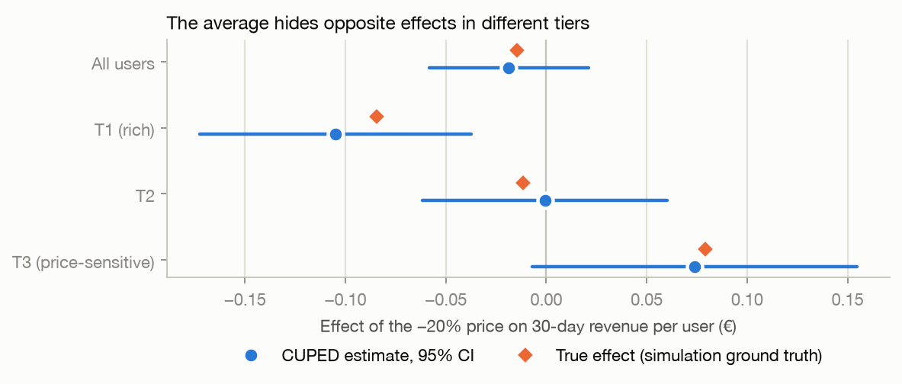

# A/B testing a subscription price: from test design to a launch decision

This project covers the whole A/B testing workflow for a product decision: power and planning, validity checks, estimation with variance reduction, sequential testing, heterogeneous effects and targeting, and the same analysis redone in SQL. I use two datasets:

* a simulated freemium app that tests a 20% lower subscription price. Because it's simulated I know the true effect for every user, so I can check each method against the right answer.
* the real Hillstrom randomized e-mail experiment (64,000 customers), where there's no answer key and the data is noisy.

> The paywall experiment is a simulation. Its parameters are my own assumptions (listed at the bottom), not data from any company. Numbers marked *(simulation)* describe that simulator; only the "Real data" row uses real observations.

## Main results

| Question | Result |
|---|---|
| Does the lower price raise revenue? *(simulation)* | Not on average. Revenue per user changes by -0.012 € (95% CI -0.056 to +0.032) even though conversion goes up by 1.0 pp. The average hides a loss for users in rich countries (T1: -0.105 €, Holm p = 0.007) and a likely gain for price-sensitive ones (T3: +0.074 €). At 60 days the overall effect is worse (-0.050 €, p = 0.03). |
| Can the methods be trusted? *(simulation)* | Over 2,000 re-runs the 95% intervals cover the truth 94.8-95.0% of the time, and A/A tests give 5.2-5.4% false positives. |
| How much does CUPED help? | 19% less variance in the simulated app and 0.04% on the real e-mail data, where the covariates explain only 0.13% of the variance. |
| What does peeking cost? *(simulation)* | Checking every day and stopping at the first p < 0.05 gives 26% false positives. O'Brien-Fleming boundaries keep it at 5% and reach a decision in 20 days instead of 28, with the same power (85%). |
| Can a broken experiment be caught? *(simulation)* | A logging bug that loses 7.8% of treated users gives an SRM p-value of 1e-68, while the covariate balance check stays under its alarm threshold (SMD 0.08 < 0.1). |
| Can ML find who to target? *(simulation)* | S, T and DR learners fitted directly on noisy revenue don't beat a constant prediction in error, and they rank users only moderately (Spearman 0.50-0.66). A structural learner (conversion CATE plus price algebra) reaches Spearman 0.81 and 85% of the oracle's gain. A one-variable tier rule does about as well. |
| Real data: which e-mail? | The Men's e-mail adds \$0.77 per customer (CI 0.49-1.05) and beats the Women's one (+\$0.42; difference +\$0.35, p = 0.03 after Holm correction). There's no reliable evidence that targeting does better than sending the Men's e-mail to everyone. |



Decision memos: [paywall price test](reports/decision_memo_paywall.md), [e-mail campaign](reports/decision_memo_hillstrom.md).

## What's in the repo

| Notebook | Topic |
|---|---|
| [01 Simulated A/B analysis](notebooks/01_simulated_ab_analysis.ipynb) | power, SRM and balance, Welch and bootstrap, CUPED, Monte Carlo check against the ground truth, guardrails and time horizon, segments with multiplicity correction, decision |
| [02 Peeking, sequential testing, SRM, novelty](notebooks/02_peeking_sequential_srm_novelty.ipynb) | why peeking inflates errors, Pocock and O'Brien-Fleming boundaries (found by simulation and checked against published values), mSPRT, a localized SRM bug, novelty effect |
| [03 Uplift modelling](notebooks/03_uplift_modelling.ipynb) | S, T, DR and structural learners, cross-fitting, Qini curves, inverse propensity policy value, calibration, readable rules |
| [04 Real data: Hillstrom](notebooks/04_hillstrom_real_data.ipynb) | data audit, SRM and balance, three-arm effects with Holm correction, why CUPED fails here, power for heterogeneity, three-action policy learning with doubly robust evaluation |
| [05 SQL (DuckDB)](notebooks/05_sql_experiment_analysis.ipynb) | health checks, one-row-per-user metrics from an event log, CUPED and daily looks in SQL, ROLLUP, cohorts, the INNER JOIN trap, with every result checked against Python |

```
src/        simulator.py  analysis.py  power.py  sequential.py  uplift.py  warehouse.py  plotting.py
sql/        11 queries (health checks, metrics view, effect, CUPED, daily z, rollup, cohorts, pitfalls, Hillstrom)
tests/      29 tests: simulator invariants, estimators vs theory, published sequential boundaries, SQL vs Python
reports/    decision memos and figures
```

## How to run it

```bash
pip install -r requirements.txt
# Real data (not redistributed here): download the Hillstrom MineThatData E-Mail Analytics challenge CSV
# from http://www.minethatdata.com/Kevin_Hillstrom_MineThatData_E-MailAnalytics_DataMiningChallenge_2008.03.20.csv
# and save it as data/raw/hillstrom_email.csv
make all        # runs the tests, then executes the five notebooks in place
```

Everything is seeded, so the simulated experiment (seed 42, 200,000 users) gives the same numbers on every run.

## Notes on the method

Every simulated user has both potential outcomes, so besides p-values I can report bias, coverage, power and policy value against the truth. Notebook 01 is analysed blind: the `true_*` columns are only used after the estimates are done.

Uplift scores are cross-fitted (each user is scored by a model that never saw them), and policies are evaluated with inverse propensity or doubly robust estimators on the randomized data. I fixed the model hyperparameters in advance and didn't tune them on the ground truth.

I kept the negative results. The segment where the discount helps (T3) isn't significant on total revenue after the multiplicity correction, CUPED does nothing on the real data, and the learned e-mail policy doesn't beat a simple rule. For each of these the notebooks show how much data it would take to settle the question.

The structural learner assumes that in-app purchases don't react to the price (I tested it: +0.005 €, p = 0.80, consistent with no effect) and that prices are known.

## Simulation assumptions

Baseline conversion is about 4.8% at 9.99 € per month. Price sensitivity (change in log-odds per unit drop in log price) is 0.4, 1.0 and 2.2 for tiers T1, T2 and T3, divided by `exp(0.25·engagement)` so that engaged users care less about price. Users won only by the discount have 0.6 lower log-odds of renewing in month 2. In-app purchases are heavy-tailed (Poisson count times log-normal amounts) and don't depend on the price. Users arrive uniformly over 28 days with 50/50 randomization.

I set the strength of the correlation between past and future spend (which drives the CUPED gain) to a level I consider realistic, and it's the least "natural" parameter in the simulator. Details are in `src/simulator.py`.

## Limitations

The simulated results show that the methods work when the simulator's assumptions hold, and they say nothing about a real product. The Hillstrom data is from 2008, covers two weeks and past-year buyers of one retailer, and measures revenue rather than profit.
